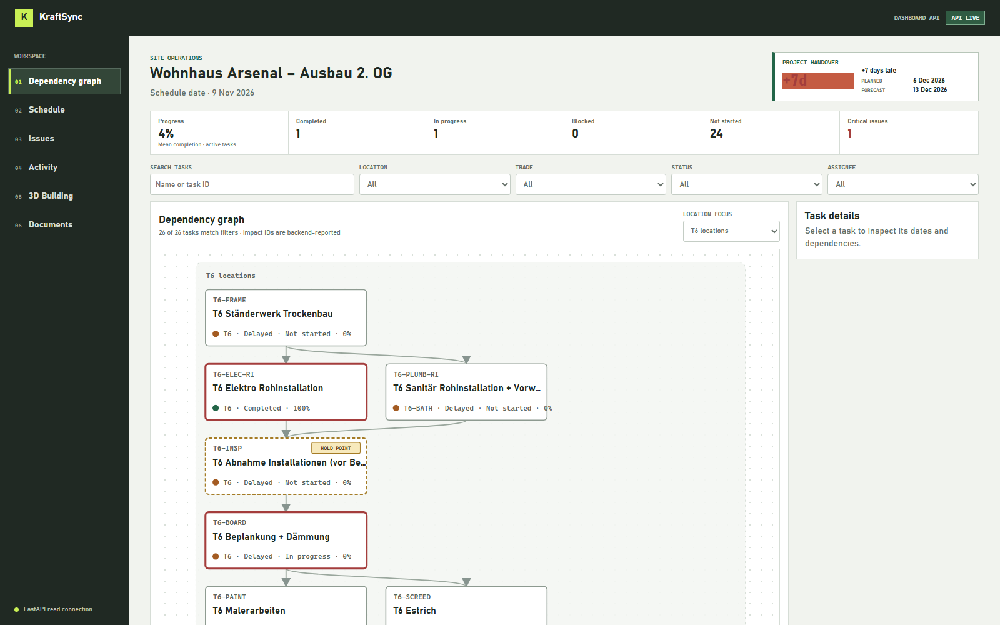
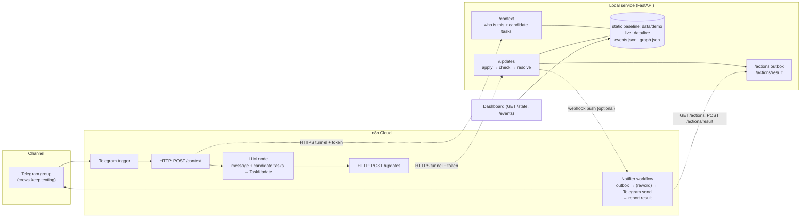
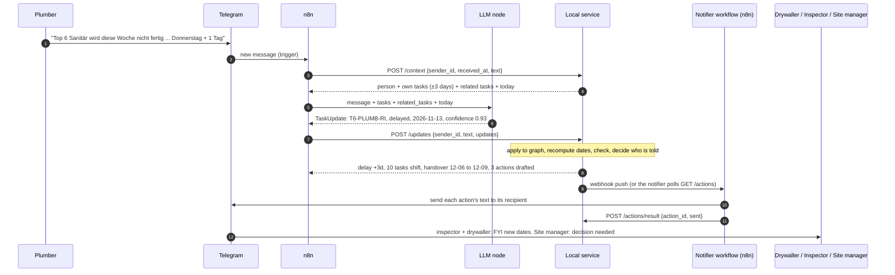
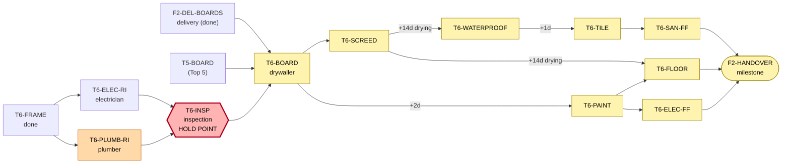

# KraftSync

[](https://github.com/NavRjn/HackTeamVienna/actions/workflows/ci.yml)


**A construction schedule that updates itself from the site chat.** Crews keep texting like they do today. KraftSync reads each message, maps it onto a dependency graph, works out what it breaks downstream, and tells *the people whose work is affected*.



- **What it does:** "plumbing will be a day late" becomes a graph update, a recomputed handover date, and a message to the inspector, the drywaller and the site manager. The plumber is not bothered.
- **The one rule: AI interprets, the graph decides.** The LLM does one job, turning a message into a structured claim. Dates, ripple, conflict detection and routing are deterministic, unit-tested Python with no LLM call.
- **Evidence:** 107 automated tests, including a replay of 10 gold-labelled site messages whose detected discrepancies all match the labels.

Built in ~36 hours at the Building Better Worlds hackathon, Vienna, November 2026, then cleaned up as a portfolio project.

## The problem

A construction schedule is a dependency graph: pipes and cables, then inspection, then the wall is closed, then screed, paint, tiles, handover. On real sites:

- The schedule lives in MS Project, Primavera or Excel, and is updated weekly at best.
- Reality lives in WhatsApp or Telegram groups, phone calls and email.
- Nobody connects the two. A plumber's "parts arrive Thursday" never reaches the drywaller who plans to close that wall on Wednesday, or the site manager whose handover date just moved.

The cost is measurable: miscommunication and poor project data cause about 48% of rework on US jobsites (≈ $31.3 bn in 2018), and site teams spend about 35% of their time on non-productive work such as hunting for information and resolving conflicts (FMI / PlanGrid, *Construction Disconnected*, 2018). In the UK, avoidable errors are estimated at about 21% of project value (Get It Right Initiative).

### What the challenge asked for

The brief was to give the physical world context for software. We read it as four requirements:

1. **Connect to what the site already uses.** No new app for crews.
2. **Keep one live record** of what changed, who said so and who decided.
3. **Flag issues as they happen**, not at the next weekly meeting.
4. **Send decisions to the right person**, and only to them.

### What is different here

- **The schedule is a live graph, not a list.** A message about one task is evaluated by its effect on every task downstream, and on the project finish date.
- **Messages become claims, never commands.** The LLM proposes ("task X, delayed, new finish Friday, confidence 0.93"); the graph decides whether and how to apply it.
- **Detection compares state before and after.** It raises only what is *newly* wrong, so a repeated message does not repeat an alarm.
- **Notification follows the graph.** The people told are those whose tasks move, within a configurable depth, plus the decision-maker, not the sender or the whole group.
- **Event-sourced and auditable.** Current state is the untouched baseline plus a replay of an append-only event log. Every change traces back to a source message.
- **Real plan formats in.** CSV, Excel, MS Project XML, Primavera P6 XER, and a reviewed LLM draft from PDF.

## One example

Bathroom wall in Apartment 6: the plumber and electrician lay pipes and cables, the inspector checks them (a hold point), the drywaller closes the wall, then screed, paint, tiles, handover.

| Someone texts | Without KraftSync | With KraftSync (within a minute) |
|---|---|---|
| Plumber: *"Parts missing, supplier says Thursday, then I need one more day"* | The drywaller turns up and cannot close the wall, or closes it anyway. | The **inspector** and **drywaller** get their new dates. The **site manager** hears *"handover moves +3 days, please decide"*. The plumber is not bothered. |
| Drywaller: *"Already started boarding the bathroom"* | The wall is closed before inspection and torn open later. | **STOP** to the site manager and the inspector: a hold point was violated. |
| Electrician: *"Client wants 2 more sockets"* | Nobody records who asked; the extra work goes unbilled. | Logged as a scope change and sent to the site manager as a change-order candidate. |

## Architecture

Telegram → n8n Cloud (the LLM reads the message) → local FastAPI service (the graph checks it) → n8n → Telegram. n8n owns chat I/O and the single AI step. The service owns state, dates, detection and routing. They talk over an HTTPS tunnel with a shared token.



| Block | Does | Does **not** |
|---|---|---|
| Channel | Where people already talk | — |
| n8n | Receives messages, asks the service for context, runs the one LLM step, sends the messages it is told to send | decide anything about the schedule |
| Local service | Sender lookup, candidate shortlist, graph state, forecast dates, conflict detection, who-gets-told rules, event log | call an LLM |

### How one message flows



The real response for this message:

```
status: applied
discrepancies: delay, critical: "T6 Sanitär Rohinstallation + Vorwand: finish 2026-11-10 -> 2026-11-13 (+3d);
                10 downstream task(s) shift; project finish 2026-12-06 -> 2026-12-09"
actions:
  P-INS  notify    "Info: T6 Abnahme Installationen ... verschiebt sich von 2026-11-11 auf 2026-11-14. ..."
  P-DRY  notify    "Info: T6 Beplankung + Dämmung verschiebt sich von 2026-11-12 auf 2026-11-15. ..."
  P-SM   escalate  "Termin 'Übergabe 2. OG' verschiebt sich 2026-12-06 → 2026-12-09 (+3 Tage). ... Bitte entscheiden."
```

The full HTTP contract is in [`docs/api.md`](docs/api.md).

## Guardrails: how the LLM is kept honest

The LLM is the only non-deterministic component, so it is confined structurally rather than by prompt alone.

| What could go wrong | What stops it |
|---|---|
| The model invents a task or person id | It may only choose from the `tasks` / `related_tasks` shortlist that `/context` returns; the service rejects unknown ids (422). |
| The model is unsure or the message is ambiguous | A claim below `CONFIDENCE_MIN` or without a task is **never applied**; the service asks the sender instead. |
| The model does date arithmetic wrong | It copies dates from a calendar table or returns "days left"; code turns that into `today + n`. |
| The model decides what counts as a conflict | It sends *claims*, not graph fragments. The graph compares before and after and decides. |
| A webhook is retried and applied twice | Every claim carries a `message_id`; repeats return `duplicate` and change nothing. |
| State is silently corrupted | Append-only event log; state = baseline + replay; `graph.json` is only a derived copy. |
| The model is swapped or changes | The Python service has no LLM call and runs in tests with the gold labels as claims, so the deterministic half stays verified. |

## How anomalies are decided

Detection compares the state **before** and **after** a claim is applied and raises only what is newly wrong.

| Check | Rule (deterministic) | Raised as | Severity |
|---|---|---|---|
| Sequence | Task started or completed while a predecessor is still open | `out_of_sequence` | warning |
| Hold point | Same, and the open predecessor is an inspection hold point | `hold_point_violation` | critical |
| Schedule | Forecast finish passes planned finish; ripple (downstream tasks, project finish before/after) from recomputing the schedule (CPM forward pass) | `delay` | critical if the project finish moves, else warning |
| Scope | Update kind `modified` | `scope_change` | warning |
| Blocked | Update kind `blocked` | `blocked` | warning |

Routing ([`policy.yaml`](kraftsync/policy/policy.yaml), [`resolve.py`](kraftsync/engine/resolve.py)): people whose tasks move within 2 steps downstream get an FYI; the site manager gets decisions (project finish moves, hold point, scope change, blocked); the sender is only ever asked to clarify; one message per person per event, the most urgent wins.

## The demo graph

26 tasks, 38 dependencies, 9 people and 10 gold-labelled German messages, all synthetic, in `data/demo/`.



Orange: the plumber's delay. Yellow: tasks that shift, so the handover moves 12-06 → 12-09. Red: the hold point the drywaller violates.

## Results

| Metric | Value |
|---|---|
| Automated tests | 107 pass, 1 skipped (Python), plus frontend unit tests |
| Detected discrepancies vs gold labels | 10 / 10 messages match on replay |
| Plan import formats | CSV, Excel, MS Project XML, Primavera P6 XER, PDF (reviewed draft) |
| LLM task-mapping accuracy, wrong-and-confident rate | Not yet measured (planned: n8n manual-trigger evaluation against the gold labels) |

## Team

Four people, four independent modules, joined by two frozen contracts ([`docs/api.md`](docs/api.md) and [`kraftsync/contracts/models.py`](kraftsync/contracts/models.py)).

### [@Aizhanaaah](https://github.com/Aizhanaaah) · Data and plan ingestion
- Built the synthetic project: a 26-task, 38-dependency, 9-person fit-out with locations, job titles and hold points.
- Wrote the importers that turn real schedule files into a validated plan: CSV, Excel, MS Project XML and Primavera P6 XER.
- Built the PDF path: an LLM draft of a plan that a human reviews and freezes, at plan time only.
- Wrote the validation and source-consistency tests, plus the generators and the tunnel helper.
- *Lives in:* `kraftsync/ingestion/`, `scripts/`, `data/demo/`

### [@GodZChild](https://github.com/GodZChild) · Telegram integration and dashboard
- Created and configured the Telegram bot and demo group (BotFather, privacy mode, sender-id mapping).
- Built the dashboard: a zoomable SVG dependency graph in location lanes, with open issues outlined.
- Added the issue-to-impact view, the live activity feed, and a project-document and BIM (IFC) viewer.
- Wrote the Node proxy that keeps the API token server-side, plus the frontend tests.
- *Lives in:* `frontend/`

### [@datenberg](https://github.com/datenberg) · n8n workflows and integration
- Built the intake workflow: Telegram trigger, context lookup, structured-output LLM step, and the request to the service.
- Built the notifier workflow: outbox to Telegram delivery, with delivery results reported back.
- Designed the prompt and its guards so a small model copies dates from a calendar table instead of computing them.
- Wired every integration end to end and ran the product testing across the full chain.
- *Lives in:* `n8n/`, [`docs/n8n-workflow.md`](docs/n8n-workflow.md)

### [@NavRjn](https://github.com/NavRjn) · Architecture and core engine
- Designed the overall architecture and the determinism rule, and froze the contracts between the modules.
- Built the dependency graph: CPM forecast and ripple, event-sourced state and the audit log.
- Built the discrepancy detection and the resolution policy that decides who is told what.
- Built the FastAPI service (token, idempotency, outbox), the test suite with the gold-message replay, and the data-quality checks.
- *Lives in:* `kraftsync/graph/`, `engine/`, `policy/`, `app/`, `contracts/`, `tests/`

## Quickstart

```bash
cp .env.example .env            # optional: the server creates the token and port itself
uv sync
uv run pytest -q
uv run python -m kraftsync.app.serve
```

The first start generates `KRAFTSYNC_TOKEN` and a random `KRAFTSYNC_PORT` into `.env`. For the dashboard:

```bash
npm --prefix frontend ci && npm --prefix frontend start   # http://127.0.0.1:5173
```

For n8n Cloud, expose the service with `uv run python scripts/tunnel.py` (starts cloudflared and prints the HTTPS base URL). n8n calls `/context` and `/updates` with the header `X-KraftSync-Token`. The workflow export goes in `n8n/`; see [`docs/n8n-workflow.md`](docs/n8n-workflow.md) for how it is built.

| Variable | Meaning |
|---|---|
| `KRAFTSYNC_TOKEN` | Shared secret, at least 24 characters (generated on first run) |
| `KRAFTSYNC_HOST` / `KRAFTSYNC_PORT` | Bind address and port (random, saved) |
| `DEMO_TODAY` | Freeze "today" for the demo story (`2026-11-09`) |
| `DEMO_REDIRECT_CHAT_ID` | Demo mode: every message goes to one chat, prefixed with the real recipient |
| `N8N_CONFLICT_WEBHOOK_URL`, `N8N_HOOK_TOKEN` | Optional push to the notifier workflow |
| `CONFIDENCE_MIN` | Below this the sender is asked instead (default 0.7) |

## Repository layout

```
kraftsync/
  contracts/    Pydantic domain models shared by all modules
  graph/        ProjectGraph: state, CPM schedule, apply, detect, context shortlist; EventStore
  engine/       resolve.py: who gets told what (deterministic)
  policy/       policy.yaml: message templates (de/en) and notify depth
  app/          FastAPI service (routes, HTTP envelopes, settings, serve entry point)
  ingestion/    CSV / Excel / MSPDI / XER / PDF  ->  ProjectPlan
frontend/       dashboard (Node proxy + SVG graph)
n8n/            LLM output schema and Code-node scripts for the workflows
data/demo/      synthetic project and gold-labelled messages (live state goes to data/live/, gitignored)
tests/          pytest, including the gold-message replay through the API
docs/           one folder per module, plus api.md and n8n-workflow.md
```

## Limitations and roadmap

- Calendar days only (no working calendars); finish-to-start and start-to-start dependencies only; one project at a time.
- Data is synthetic; detection is only as good as the dependencies in the imported plan.
- LLM interpretation accuracy is not yet measured.
- Planned checks: contradicting reports, silent overdue tasks (timer), work not in the graph.
- Planned channels: WhatsApp and email, through n8n.

## Docs

| Folder | Content |
|---|---|
| [`docs/api.md`](docs/api.md) | HTTP contract between n8n and the service |
| [`docs/n8n-workflow.md`](docs/n8n-workflow.md) | The n8n workflows, node by node |
| [`docs/00-overview`](docs/00-overview) | Problem, product, demo story |
| [`docs/01-architecture`](docs/01-architecture) | Data flow, determinism rule, contracts |
| [`docs/02-ingestion`](docs/02-ingestion) | Plan import |
| [`docs/03-integrations`](docs/03-integrations) | Channels (Telegram via n8n) |
| [`docs/04-graph`](docs/04-graph) | Forecast, discrepancy rules, events |
| [`docs/05-engine`](docs/05-engine) | Interpretation and the `/updates` pipeline |
| [`docs/06-resolution-policy`](docs/06-resolution-policy) | Who gets told what |
| [`docs/07-deployment-demo`](docs/07-deployment-demo) | Running, tunnel, security, demo |

## License

[MIT](LICENSE)
