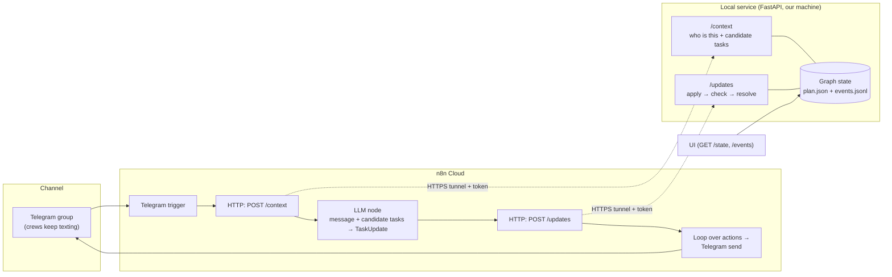
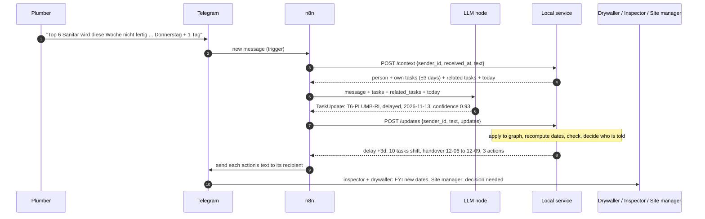
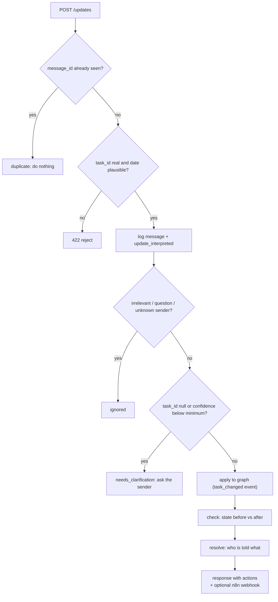
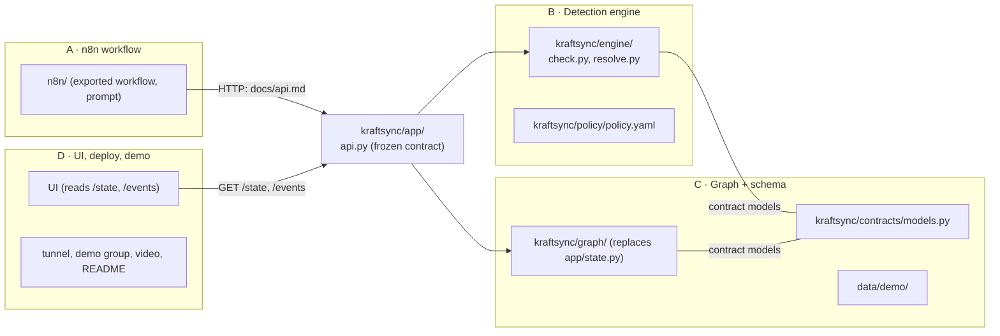
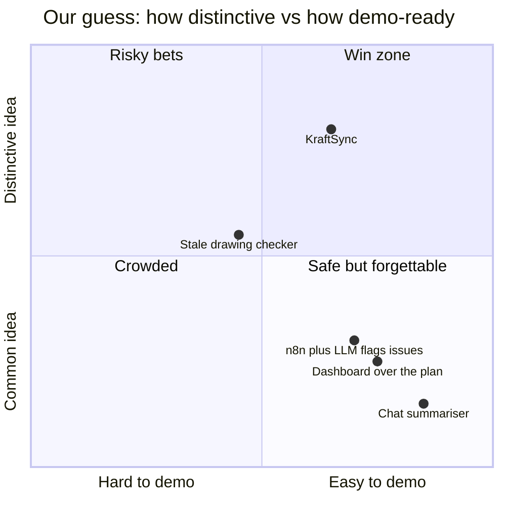

# KraftSync

The site chat becomes a live construction schedule. Every "done", "late" or "we already started" message is checked against a dependency graph, and everyone whose work moves hears about it in minutes.

Building Better Worlds Hackathon, Vienna 2026 · Track 01 · Talona — *Context for the Physical World*.

> **The one rule: AI interprets, the graph decides.** The LLM (inside n8n) only turns a chat message into a structured claim. Everything after that — dates, ripple, conflicts, who gets told — is deterministic, tested Python.

## What it does, in one example

Bathroom wall in Apartment 6. Plumber and electrician lay pipes and cables → the inspector checks them → the drywaller closes the wall → screed, paint, tiles → handover.

| The plumber texts | Today | With KraftSync (within a minute) |
|---|---|---|
| *"Parts missing, supplier says Thursday, then I need one more day"* | The drywaller's crew shows up Thursday and can't close the wall, or closes it anyway. | The **inspector** and the **drywaller** hear their new dates. The **site manager** hears *"handover moves +3 days, please decide"*. The plumber is not bothered. |
| The drywaller texts *"Already started boarding the bathroom"* | The wall is closed before the inspection; it is torn open later. | **STOP** goes to the site manager and the inspector immediately: a hold point was violated. |
| The electrician texts *"Client wants 2 more sockets"* | Nobody records who asked; the extra work goes unbilled. | Logged as a scope change and sent to the site manager to approve as a change order. |

## Architecture

Three blocks. Telegram is the only channel for now.



| Block | Does | Does **not** |
|---|---|---|
| Channel | Where people already talk | — |
| n8n | Receives messages, asks the local service for context, runs the one LLM step, sends the messages we tell it to | decide anything about the schedule |
| Local service | Sender lookup, candidate shortlist, graph state, conflict detection, who-gets-told rules, event log | call an LLM |

## How one message flows (demo message 02)



### The two calls, step by step

**1. `POST /context`: "who is this, and what could they be talking about?"**

```json
// request
{ "sender_id": 123456789, "received_at": "2026-11-09T08:15:00+01:00",
  "text": "Top 6 Sanitär wird diese Woche nicht fertig ..." }
// response (shortened)
{
  "person": { "id": "P-SAN", "name": "Emre Yılmaz", "role": "foreman", "trade": "plumbing", "language": "de" },
  "tasks": [ { "id": "T6-PLUMB-RI", "name": "T6 Sanitär Rohinstallation + Vorwand", "status": "in_progress",
               "planned_finish": "2026-11-10" } ],
  "related_tasks": [ { "id": "T6-INSP", "name": "T6 Abnahme Installationen (vor Beplankung)", "responsible_person_id": "P-INS" },
                     "... other people's tasks that may be meant ..." ],
  "today": "2026-11-09"
}
```
Two lists, at most 15 each, kept apart on purpose:
- `tasks`: the sender's **own** tasks (assigned to them or their trade) that are active within **±3 days** of today: in progress, overlapping the window, overdue and still open, or just finished.
- `related_tasks`: **other people's** tasks that may be what the message is about: tasks at locations named in the text ("Top 6", "Bad Top 6"), direct predecessors/successors of the sender's tasks, other tasks active now.

The LLM may only choose a `task_id` from these two lists (or null) and should prefer `tasks`.

The sender is identified by their **Telegram user id** (`message.from.id`), matched to `telegram_chat_id` in the plan. An unknown id gets empty lists. "Today" is the message date (`received_at`), unless `DEMO_TODAY` is set, which always wins.

**2. n8n's LLM node produces one `TaskUpdate` per claim.** This is the data format between n8n and the service: a JSON object that is one *claim about one task*. One chat message can carry several claims ("plumbing done, tiling will be late"). It is the `TaskUpdate` model in `kraftsync/contracts/models.py`.

| Field | Filled by | Example |
|---|---|---|
| `message_id` | n8n, unique **per claim**: Telegram chat id + message id + `#n`; idempotency key | `"tg:-100123:456#1"` |
| `task_id` | LLM, from `tasks` / `related_tasks` only (prefer `tasks`), or `null` | `"T6-PLUMB-RI"` |
| `kind` | LLM | `started` · `progress` · `completed` · `delayed` · `blocked` · `unblocked` · `modified` · `question` · `irrelevant` |
| `confidence` | LLM (0–1) | `0.93` |
| `new_forecast_finish` | LLM, resolves "Donnerstag + 1 Tag" using `today` | `"2026-11-13"` |
| `blocker`, `change_description`, `percent_complete` | LLM, when relevant | `"pre-wall elements not delivered"` |
| `rationale` | LLM, one short sentence (shown to the manager) | `"supplier Thursday, +1 day"` |
| `reported_on`, `model` | n8n | `"2026-11-09"`, `"n8n-claude-v1"` |

**3. `POST /updates`: "apply this claim, tell me what it breaks."**

```json
{ "sender_id": 123456789, "text": "<original message>", "received_at": "2026-11-09T08:15:00+01:00",
  "updates": [ { "message_id": "demo:02", "task_id": "T6-PLUMB-RI", "kind": "delayed", "confidence": 0.93,
              "reported_on": "2026-11-09", "new_forecast_finish": "2026-11-13",
              "blocker": "pre-wall elements not delivered", "rationale": "supplier Thursday, +1 day", "model": "n8n-claude" } ] }
```
The response (real output for this message):
```
status: applied
discrepancies: delay, critical: "T6 Sanitär Rohinstallation + Vorwand: finish 2026-11-10 -> 2026-11-13 (+3d);
                10 downstream task(s) shift; project finish 2026-12-06 -> 2026-12-09"
actions:
  P-INS  notify    "Info: T6 Abnahme Installationen ... verschiebt sich von 2026-11-11 auf 2026-11-14. Grund: ..."
  P-DRY  notify    "Info: T6 Beplankung + Dämmung verschiebt sich von 2026-11-12 auf 2026-11-15. Grund: ..."
  P-SM   escalate  "Termin 'Übergabe 2. OG' verschiebt sich 2026-12-06 → 2026-12-09 (+3 Tage). ... Bitte entscheiden."
recipients: { person_id → name + telegram_chat_id }   // so n8n can send without a second lookup
```
`actions` and `recipients` are merged over all claims (per-claim detail is in `results`). n8n loops over `actions` and sends `text` to `recipients[to_person_id].telegram_chat_id`. Statuses (per claim; the top-level one is the most "applied" of them): `needs_clarification` (low confidence: one `ask` action to the sender, nothing applied), `ignored` (chit-chat, questions, unknown sender), `duplicate` (same `message_id` again: safe to retry).

Full contract and all routes: [`docs/api.md`](docs/api.md).

## What happens inside `/updates`



### How anomalies are decided

Detection compares the **state before** and **after** the claim was applied. It raises only what is **newly** wrong, so repeating a message does not repeat an alarm.

| Check | Rule (deterministic) | Raised as | Severity | Built |
|---|---|---|---|---|
| Sequence | task started or completed while a predecessor is still open | `out_of_sequence` | warning | yes |
| Hold point | same, and the open predecessor is a hold point (inspection) | `hold_point_violation` | critical | yes |
| Schedule | forecast finish passes the planned finish; the ripple (affected downstream tasks, project finish before/after) comes from recomputing the schedule before and after | `delay` | critical if the project finish moves, else warning | yes |
| Scope | update kind `modified` | `scope_change` | warning | yes |
| Blocked | update kind `blocked` | `blocked` | warning | yes |
| Contradiction | claim contradicts state (e.g. "started" on a done task, two conflicting reports) | `conflicting_reports` | warning | planned |
| Silence | task overdue and nobody reported | `silent_overdue` | info → warning | planned (timer) |
| Unknown work | message about work not in the graph | `unknown_task` | info | planned |

Who is told ([`kraftsync/policy/policy.yaml`](kraftsync/policy/policy.yaml) texts, rules in `kraftsync/engine/resolve.py`): people whose tasks move within 2 steps downstream get an FYI; the site manager gets decisions (project finish moves, hold point, scope change, blocked); the sender is only asked to clarify; one message per person per event, the most urgent wins.

## The demo graph (Top 6)


Orange: the plumber's delay (message 02). Yellow: tasks that shift, so the handover moves 12-06 → 12-09. Red: the hold point the drywaller violates in message 05. Demo data: 26 tasks, 38 dependencies, 9 people, 10 gold-labelled German messages in `data/demo/`.

## Who owns what

One directory per person; only edit your own. The interfaces between them are fixed (`docs/api.md`, `kraftsync/contracts/models.py`) and everyone can work against fixtures until integration.


| Owner | Scope | Hands over |
|---|---|---|
| A · n8n | Telegram trigger → `/context` → LLM node → `/updates` → send actions | The workflow JSON and the prompt |
| B · Detection | `check()` and `resolve_all()`: more rules (contradictions, silent overdue), better texts | Rules with tests on the gold messages |
| C · Graph + schema | Contract models, graph state/replay (replaces the placeholder `app/state.py`), demo data | Models stay additive; breaking changes announced, because n8n's schema depends on them |
| D · UI + deploy | Graph view with the handover date, event feed, tunnel, demo Telegram group, 3-min video | A page that only needs `GET /state` and `GET /events` |

## Plan to code freeze

```mermaid
gantt
    title Friday evening to code freeze (approximate)
    dateFormat YYYY-MM-DD HH:mm
    axisFormat %a %H:%M
    section Done
    Local API, detection v0, tests, tunnel :done, d1, 2026-11-13 19:00, 2h
    section Fri night
    n8n flow end to end on message 02 :active, a1, 2026-11-13 21:00, 90m
    Telegram demo group + real chat ids :a2, 2026-11-13 21:00, 90m
    UI against /state and /events :a3, 2026-11-13 21:30, 3h
    section Sat morning
    Detection: contradictions, silent overdue :b1, 2026-11-14 08:00, 2h
    n8n and Adaption workshops :milestone, w1, 2026-11-14 11:00, 0m
    Rehearse full demo, reset between runs :c1, 2026-11-14 10:00, 2h
    Record 3-min video :crit, v1, 2026-11-14 12:30, 1h
    section Submission
    README, licence check, submit form :s1, 2026-11-14 13:30, 90m
    Code freeze :crit, milestone, f1, 2026-11-14 15:00, 0m
```

## Hackathon analysis

**Differentiation.** The track asks to catch a problem on site early enough for someone to act. Our guess at what other teams will build is below; it is a judgement, not data.


- **What sets us apart:** a message reaches the people downstream of it, not just the sender; the hold-point catch is deterministic and explainable (it is the example on Talona's own slide); crews change nothing about how they work.
- **Risks:** n8n plus an LLM alone looks generic, so the ripple (handover date moving) must be visible on stage; live Telegram and Wi-Fi can fail (manual message box and replay are the fallback); the data is synthetic; detection is only as good as the dependencies in the plan.

**Economics.** The Talona brief cites ~$1.85 tn lost to bad data and miscommunication in 2020. `docs/00-overview` also cites FMI/PlanGrid figures (≈48% of rework from miscommunication, ≈35% of site time non-productive); **verify these before using them in the pitch**. Where the value comes from, per site:

| Lever | Value | What we must validate with a mentor |
|---|---|---|
| Hold-point catches | rework avoided (open wall, re-inspect) | cost of one tear-out |
| Downstream warnings | idle crew-days avoided | day rate × days lost per late delivery |
| Scope changes captured | change orders that would have gone unbilled | share of extras never invoiced |
| Fewer coordination calls | site-manager time | hours per week |

Adoption cost is near zero (no new app for crews), which is what usually kills construction tools.

**Engineering quality.** The LLM is confined to one step and can only choose from a candidate list; low confidence asks instead of guessing; every change is an append-only event; detection is pure functions with a replay test against the 10 gold messages; API is token-protected and idempotent. Weak spots: calendar days only, finish-to-start and start-to-start dependencies only, one project, no accuracy numbers for the LLM step yet.

## Quickstart

```bash
cp .env.example .env            # optional: the server creates the token and port itself
uv sync
uv run pytest -q
uv run python -m kraftsync.app.serve
```
The first start generates `KRAFTSYNC_TOKEN` and a random `KRAFTSYNC_PORT` into `.env` and prints the URL and the token header. Share the token privately; it is the only lock, and it is sent over plain HTTP on the LAN.

For n8n Cloud, expose the local port with a tunnel:
```bash
cloudflared tunnel --url http://127.0.0.1:<KRAFTSYNC_PORT>     # prints https://<random>.trycloudflare.com
```
In n8n, call `<that URL>/context` and `<that URL>/updates` with the header `X-KraftSync-Token`. The URL changes whenever the tunnel restarts.

| Variable | Meaning |
|---|---|
| `KRAFTSYNC_TOKEN` | Shared secret, at least 24 characters (generated on first run) |
| `KRAFTSYNC_HOST` / `KRAFTSYNC_PORT` | Bind address (default all interfaces) and port (random, saved) |
| `DEMO_TODAY` | Freeze "today" for the demo story (`2026-11-09`) |
| `DEMO_REDIRECT_CHAT_ID` | Stage mode: every message goes to this one chat, prefixed with the real recipient |
| `N8N_CONFLICT_WEBHOOK_URL`, `N8N_HOOK_TOKEN` | Optional: we also call this n8n webhook when there is a conflict |
| `CONFIDENCE_MIN` | Below this the sender is asked instead (default 0.7) |

## Docs

| Folder | Content |
|---|---|
| `docs/api.md` | The HTTP contract between n8n and the local service |
| `docs/n8n-workflow.md` | The n8n workflow, node by node (for the n8n owner) |
| `docs/00-overview` | Problem, product, demo story; `open-questions.md` lists what still needs a decision |
| `docs/01-architecture` | Three blocks, data flow, determinism rule, contracts, interfaces |
| `docs/02-ingestion` | Plan import (stretch, not built) |
| `docs/03-integrations` | Channels: Telegram via n8n |
| `docs/04-graph` | Forecast, discrepancy rules, events (what is built vs planned) |
| `docs/05-engine` | Interpretation (n8n LLM node) and the `/updates` pipeline, evaluation plan |
| `docs/06-resolution-policy` | Who gets told what |
| `docs/07-deployment-demo` | Running the service, tunnel, security, UI, demo checklist, submission |

## Results

| Metric | Value |
|---|---|
| Unit/API tests | 21 passing (includes a replay of all 10 gold demo messages) |
| Detected discrepancies vs gold labels | 10 / 10 messages match |
| LLM task mapping accuracy, update-kind accuracy, wrong-and-confident rate | TBD (n8n LLM step not measured yet) |
| Message → notification latency | TBD |

## Assumptions

- Demo project and chat messages are synthetic (`data/demo/`), generated to be schedule-consistent.
- Calendar days, no working calendars.
- Each demo person's Telegram user id must be set as `telegram_chat_id` in the plan (via `scripts/generate_demo_plan.py`, which writes both `persons.csv` and `plan.json`; the service reads `plan.json`). Without it the person is an unknown sender and their messages are ignored.
- Licence: the repo carries an MIT `LICENSE`, but the Talona slide says Talona work goes to a private repository. Confirm with the organisers before submitting.
