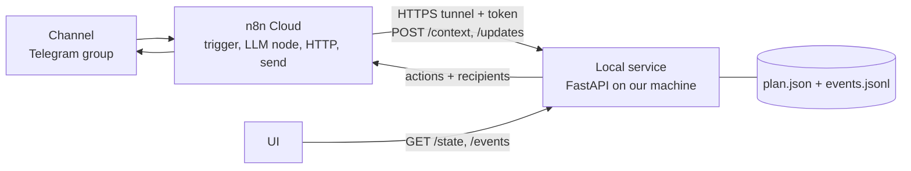

# 01 · Architecture

Current as of Fri 13 Nov 2026 (evening). This replaces the earlier all-in-Python design: **n8n now owns the chat I/O and the one AI step; a local FastAPI service owns everything deterministic.** Contract between them: [`docs/api.md`](../api.md).

## The three blocks



| Block | Does | Does not |
|---|---|---|
| Channel | Where crews already talk (Telegram first; WhatsApp/email later, via n8n) | — |
| n8n (Cloud) | Receive messages, call `/context`, run the LLM step (message + candidate tasks → claims), call `/updates`, send the returned messages | decide anything about the schedule |
| Local service | Sender lookup, candidate shortlist, graph state, forecast, conflict detection, who-gets-told, event log | call an LLM |

## Live data flow

```
Telegram message
  → n8n: Telegram Trigger, Normalize (full name, ISO time, unique id)
  → n8n: POST /context {sender_name, received_at, text}
        local: resolve sender by full name; shortlist <= 15 candidate tasks        (deterministic)
  → n8n: LLM node  — the ONLY AI step
        message + candidates + today  →  claims[]  (task_id from candidates or null, kind, confidence, dates, rationale)
  → n8n: add message_id / reported_on / model, guard task ids, POST /updates {sender_name, text, updates[]}
        local, per claim:                                                          (deterministic)
          duplicate?  → stop
          unknown task id / implausible date → 422
          irrelevant / question / unknown sender → ignored
          task_id null or confidence < CONFIDENCE_MIN → ask the sender (nothing applied)
          else apply to state → check(before, after) → resolve(who is told) → actions
  ← response: discrepancies, actions[], recipients{}
  → n8n: for each action, Telegram Send to recipients[to_person_id].telegram_chat_id
```
Optional: the service also POSTs the conflict to `N8N_CONFLICT_WEBHOOK_URL` when there is something to tell. n8n can just use the `/updates` response; the webhook is for events the server starts itself (later: overdue timer).

## The determinism rule

| Step | Deterministic? | Where | Why |
|---|---|---|---|
| Plan load (`plan.json`; CSV/MS Project/P6 later) | yes | local | parsers |
| PDF ingestion | AI allowed, output reviewed and frozen into `plan.json` first | plan time | not live |
| Sender resolution (full name) | yes | local | lookup in persons list |
| Candidate shortlist | yes | local | own open tasks, locations named in the text, dates near today |
| **Message → claims (`TaskUpdate`)** | **no (LLM)** | **n8n** | natural language, slang, German/English mix |
| Guards on the claim (id exists, date ±60 days, confidence gate, idempotency) | yes | local | an LLM output is never applied blindly |
| Apply, forecast, discrepancy detection | yes | local | testable, explainable |
| Who gets told what | yes | local | `policy.yaml` templates + rules in `engine/resolve.py` |
| Wording of outbound text | templates (de/en); LLM rewording optional, not built | local | cosmetic |

Consequence: discrepancies are explainable ("T6-BOARD started while predecessor T6-INSP is not_started") and unit-tested. The demo never depends on an LLM "noticing" an anomaly. The LLM can only choose among candidate ids we give it.

## Ontology (summary — details in `04-graph`)

- **Node = Task** (work, inspection, delivery, milestone). Location, trade, responsible person, planned/actual/forecast dates, status, `hold_point`, optional BoQ ref.
- **Edge = Dependency** (FS/SS/FF/SF + lag + reason). Only FS and SS are evaluated for now.
- **Person** (role = authority, `job_title` = craft, trade) and **Location** (tree) are reference entities by id, not graph nodes.
- **Event** = append-only record of a change (`GraphEvent`). Events are not nodes.
- **Discrepancy** = derived from state before/after a claim; carries an **Impact** (delay days, affected downstream ids, project finish before/after).
- **Action** = what the policy wants sent to whom.

## Contracts

`kraftsync/contracts/models.py` is the single source of truth for the domain models; the HTTP envelope models live in `kraftsync/app/api_models.py` (`UpdateRequest`, `UpdateResponse`, `ContextRequest/Response`, ...) so a schema refactor does not touch the wire format by accident.

| Producer → consumer | Model | Status |
|---|---|---|
| plan file → local state | `ProjectPlan` | in use (`PLAN_PATH`) |
| n8n → local service | `TaskUpdate` (one per claim, inside `UpdateRequest.updates`) | in use |
| local state → log, UI | `GraphEvent` | in use: `message_received`, `update_interpreted`, `task_changed`, `discrepancy_raised` |
| check → resolve | `Discrepancy` (+ `Impact`) | in use |
| resolve → n8n | `Action` | in use |
| channel → engine | `InboundMessage` | defined, **not used**: n8n normalises the message itself. Kept for a possible Python integration |
| unused event kinds | `plan_loaded`, `discrepancy_resolved`, `action_sent`, `manual_override` | not emitted yet (the service does not know if n8n delivered an action) |

Rules: additive changes (new optional field) are fine; renames, removals and type changes need the whole team. The n8n structured-output schema is derived from `TaskUpdate`, so changing it also changes the n8n prompt/schema.

## Public interfaces (as built)

HTTP (the boundary other teammates code against): `GET /health`, `POST /context`, `POST /updates`, `GET /state`, `GET /events`, `POST /reset` — see `docs/api.md`.

Python (pure functions unless noted):
```python
# kraftsync/engine/check.py
def forecast(tasks: dict[str, Task], deps: list[Dependency]) -> dict[str, tuple[date, date]]   # forward pass
def project_finish(fc, tasks, deps) -> date | None
def unfinished_predecessors(task_id, tasks, deps) -> list[Task]
def check(before: dict[str, Task], after: dict[str, Task], deps, update: TaskUpdate, now) -> list[Discrepancy]

# kraftsync/engine/resolve.py   (rules/texts from kraftsync/policy/policy.yaml)
def resolve_all(discrepancies, before, after, deps, persons, update, sender, now) -> list[Action]
def ask_clarification(sender: Person, options: list[Task], message_id: str, now) -> Action

# kraftsync/app/state.py   (placeholder for the graph package; owns state + events.jsonl)
class ProjectState:
    resolve_sender(full_name) -> Person | None          # full name only, ignores case/accents/spaces
    candidates_for(person_id, today, text="") -> list[Task]
    apply(update, actor, now) -> GraphEvent | None
    record_discrepancy(d, now) -> GraphEvent
    log(kind, actor, now, ...) -> GraphEvent;  has_message(message_id);  reset()
```

## Runtime

- **Two processes plus a tunnel.** n8n Cloud; the local FastAPI service (`uv run python -m kraftsync.app.serve`); `cloudflared` quick tunnel from n8n Cloud to the service's port. Details: `07-deployment-demo`.
- **State:** `plan.json` + append-only `data/events.jsonl` (`EVENTS_PATH`); current state = plan + replay of events. In-memory while running. No database; SQLite is a later option, not a dependency.
- **Config** only via env vars (`.env`, see `.env.example`).
- **Security:** every route except `/health` needs `X-KraftSync-Token`; the service refuses to start without a strong token; docs and access log are off.

## Decisions (and why)

| Decision | Why |
|---|---|
| n8n for chat I/O + the LLM step | A teammate already runs a scope-creep workflow there; sponsor tooling; no bot code to write |
| Conflict detection local and deterministic, not in n8n | Testable, explainable, reproducible; the LLM only makes claims (see README, "who should detect") |
| Claim about one task, not a graph fragment from the LLM | Comparing an LLM-made graph with the real one would just find the LLM's mistakes |
| Pydantic + JSON files, no Supabase | Nobody on the team knows Supabase; everyone knows Pydantic; one state owner |
| Full-name sender identity | Telegram supplies first + last name; names are synthetic in the demo. Not authentication (see `docs/api.md`) |
